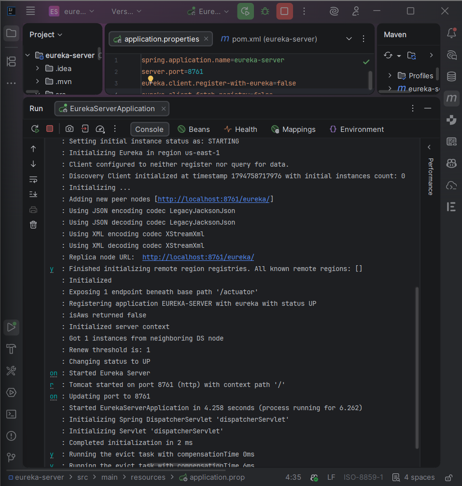
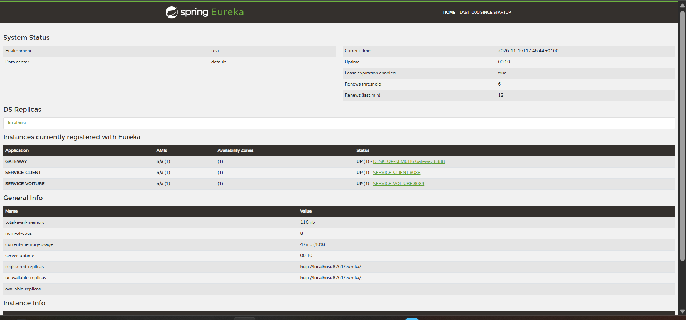
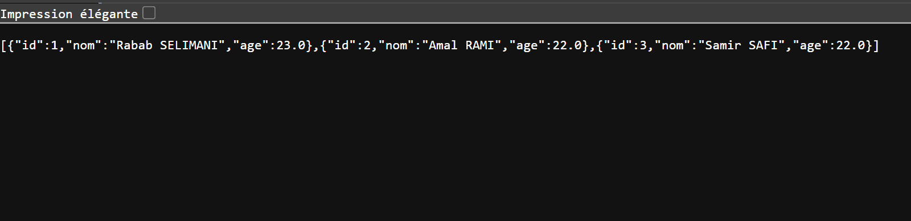
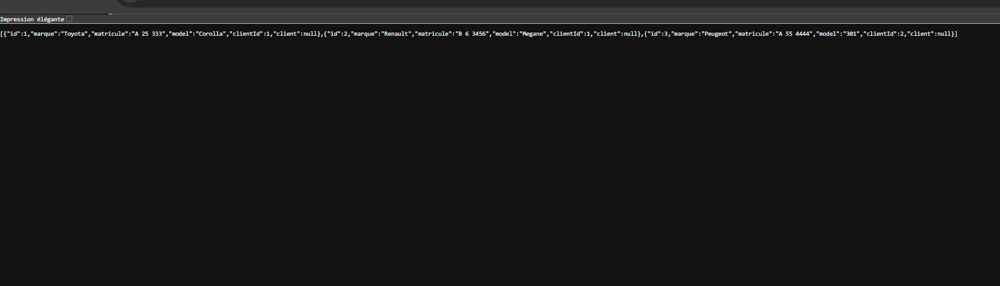
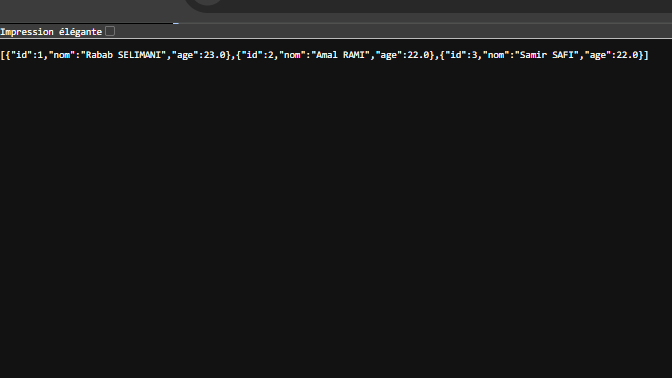
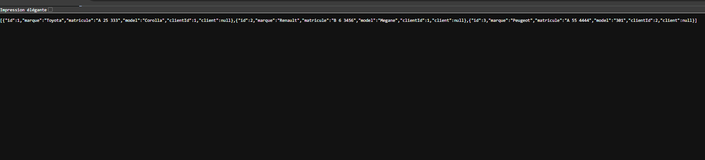
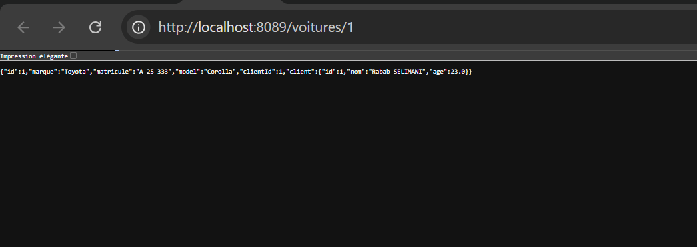
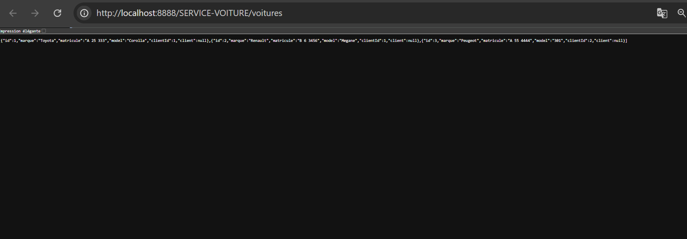

# TP 19 : Orchestration de microservices avec Spring Cloud (Eureka, Gateway et OpenFeign)

Architecture **microservices** construite avec **Spring Boot** et **Spring Cloud** : un serveur de découverte **Eureka**, une **API Gateway** comme point d'entrée unique, et deux microservices métier (**SERVICE-CLIENT** et **SERVICE-VOITURE**) qui communiquent entre eux grâce à **OpenFeign**.

## Objectifs

- Comprendre le rôle de **Spring Cloud** dans une architecture microservices
- Mettre en place un registre de services avec **Eureka Server**
- Enregistrer automatiquement des microservices auprès d'Eureka (**Eureka Discovery Client**)
- Exposer un **point d'entrée unique** avec **Spring Cloud Gateway** : routage statique, routage via Eureka (`lb://`) et routage dynamique
- Faire communiquer deux microservices avec **OpenFeign**
- Donner à chaque service sa propre base de données (**H2** en mémoire)

## Architecture

```
                 ┌─────────────────────┐
  Client  ─────► │   Gateway   :8888   │   point d'entrée unique
 (navigateur)    └──────────┬──────────┘
                            │  « où est SERVICE-CLIENT ? »
                 ┌──────────▼──────────┐
                 │   Eureka    :8761   │   annuaire des services
                 └──────────▲──────────┘
             s'enregistrent │
        ┌───────────────────┴──────────────────┐
┌───────┴─────────────┐    OpenFeign    ┌──────┴──────────────┐
│ SERVICE-CLIENT 8088 │ ◄────────────── │ SERVICE-VOITURE 8089 │
│   H2 : clients      │                 │   H2 : voitures      │
└─────────────────────┘                 └──────────────────────┘
```

| Service | Port | Rôle |
|---|---|---|
| **eureka-server** | 8761 | Registre : chaque microservice y publie son nom logique et son adresse |
| **service-client** | 8088 | CRUD des clients (H2) |
| **service-voiture** | 8089 | Gestion des voitures (H2) ; récupère le client propriétaire via **OpenFeign** |
| **gateway** | 8888 | Point d'entrée unique ; route les requêtes vers les services |

### Flux d'une requête
1. Au démarrage, chaque microservice **s'enregistre** auprès d'Eureka sous son `spring.application.name`.
2. Le client appelle la **Gateway** (`http://localhost:8888/...`).
3. La Gateway trouve la route correspondante. Avec `lb://SERVICE-NAME`, elle demande à **Eureka** les instances disponibles.
4. Le **LoadBalancer** choisit une instance et la requête lui est transmise.
5. Si nécessaire, le service appelle un autre service (**Feign + Eureka**).
6. La réponse remonte jusqu'au client.

## Technologies

| Outil | Version |
|---|---|
| Java (JDK) | 17+ (exécuté avec JDK 23) |
| Spring Boot | 3.5.x |
| Spring Cloud | 2025.0.x |
| Netflix Eureka (Server / Client) | via Spring Cloud |
| Spring Cloud Gateway (WebFlux) | via Spring Cloud |
| Spring Cloud OpenFeign | via Spring Cloud |
| Spring Data JPA + H2 | via Spring Boot |
| Lombok | géré par Spring Boot |
| IDE | IntelliJ IDEA |

## Structure du dépôt

```
tp19-spring-cloud-eureka-gateway-openfeign
├── eureka-server/        # @EnableEurekaServer
├── service-client/       # entities, repositories, controllers
├── service-voiture/      # entities, models, repositories, services (Feign), controllers
├── gateway/              # routes statiques, lb:// et dynamiques
├── screenshots/
└── README.md
```

## Détail des services

### 1. Eureka Server (8761)
```properties
server.port=8761
eureka.client.register-with-eureka=false
eureka.client.fetch-registry=false
```
`@EnableEurekaServer` transforme l'application en registre. Les deux propriétés empêchent le serveur de s'enregistrer auprès de lui-même.

### 2. SERVICE-CLIENT (8088)
- Entité `Client` (`id`, `nom`, `age`) et `ClientRepository` (Spring Data JPA)
- `ClientController` : `GET /clients` et `GET /client/{id}`
- 3 clients insérés au démarrage avec un `CommandLineRunner`
- Enregistré dans Eureka sous le nom **SERVICE-CLIENT** (`@EnableDiscoveryClient`)

### 3. SERVICE-VOITURE (8089)
- Entité `Voiture` (`id`, `marque`, `matricule`, `model`, `clientId`) : seul l'**identifiant** du client est stocké
- Le champ `client` est `@Transient` : il n'est pas stocké en base, il est rempli à la demande en appelant SERVICE-CLIENT
- Client **Feign** :
```java
@FeignClient(name = "SERVICE-CLIENT")
public interface ClientService {
    @GetMapping("/client/{id}")
    Client clientById(@PathVariable("id") Long id);
}
```
  Feign demande à Eureka l'adresse de SERVICE-CLIENT puis effectue l'appel HTTP automatiquement.
- `VoitureController` : `GET /voitures`, `GET /voitures/{id}`, `GET /voitures/client/{id}`, `POST /voitures/{clientId}`, `PUT /voitures/{id}`
- Au démarrage, le `CommandLineRunner` appelle SERVICE-CLIENT via Feign puis insère 3 voitures

### 4. Gateway (8888)
**Routage statique** (`application.yml`, URL fixes) :
```yaml
spring:
  cloud:
    gateway:
      server:
        webflux:
          routes:
            - id: r1
              uri: "http://localhost:8088"
              predicates:
                - Path=/clients/**
```
**Routage via Eureka** (nom logique + load balancing) :
```java
@Bean
RouteLocator routes(RouteLocatorBuilder builder) {
    return builder.routes()
            .route(r -> r.path("/clients/**", "/client/**").uri("lb://SERVICE-CLIENT"))
            .route(r -> r.path("/voitures/**").uri("lb://SERVICE-VOITURE"))
            .build();
}
```
**Routage dynamique** : une route est créée automatiquement pour chaque service présent dans Eureka (`/SERVICE-CLIENT/...`, `/SERVICE-VOITURE/...`) :
```java
@Bean
DiscoveryClientRouteDefinitionLocator routesDynamique(
        ReactiveDiscoveryClient rdc, DiscoveryLocatorProperties dlp) {
    return new DiscoveryClientRouteDefinitionLocator(rdc, dlp);
}
```

## Lancer le projet

Démarrer les services **dans cet ordre** :
1. `eureka-server` → http://localhost:8761
2. `service-client` (attendre qu'il apparaisse dans Eureka, environ 30 s)
3. `service-voiture` (il appelle SERVICE-CLIENT dès son démarrage)
4. `gateway`

| URL | Description |
|---|---|
| http://localhost:8761 | Tableau de bord Eureka |
| http://localhost:8088/clients | Clients (accès direct) |
| http://localhost:8089/voitures | Voitures (accès direct) |
| http://localhost:8888/clients | Clients via la Gateway |
| http://localhost:8888/voitures | Voitures via la Gateway |
| http://localhost:8888/SERVICE-CLIENT/clients | Routage dynamique |
| http://localhost:8888/SERVICE-VOITURE/voitures | Routage dynamique |

## Corrections apportées à l'énoncé

| Problème dans l'énoncé | Correction |
|---|---|
| Versions récentes de Spring Cloud : la Gateway a été renommée | `spring-cloud-starter-gateway-server-webflux` et propriétés `spring.cloud.gateway.server.webflux.routes` |
| Feign appelait `/clients/{id}` alors que le contrôleur expose `/client/{id}` | Chemin Feign corrigé en `/client/{id}`, avec `@PathVariable("id")` explicite |
| `@Transient` + `@ManyToOne` sur `client` : `Client` n'est pas une entité dans SERVICE-VOITURE | Seul `@Transient` est conservé |
| Mélange `id_client` / `clientId` | Un seul nom (`clientId`) utilisé partout, comme le recommande l'énoncé |
| Ids forcés (1, 2, 3) avec `@GeneratedValue` (erreur avec Hibernate 6.6) | Ids générés par la base (`null` à l'insertion) |
| `VoitureService` utilisée sans être définie | Classe `VoitureService` créée |
| Spring Data REST exposait aussi `/clients` | Déplacé sous `/api` (`spring.data.rest.base-path=/api`) |
| Gateway sans Eureka Client impossible à router avec `lb://` | Dépendance `spring-cloud-starter-netflix-eureka-client` ajoutée |

## Résultats

### 1. Démarrage du serveur Eureka


### 2. Tableau de bord Eureka : GATEWAY, SERVICE-CLIENT et SERVICE-VOITURE enregistrés
Les trois services sont **UP** et se sont enregistrés automatiquement avec leur nom logique et leur port.



### 3. Liste des clients : SERVICE-CLIENT


### 4. Liste des voitures : SERVICE-VOITURE
Chaque voiture contient l'identifiant de son propriétaire (`clientId`). Dans la liste, le champ `client` vaut `null` : comme dans l'énoncé, il n'est rempli via Feign que pour une voiture précise (`/voitures/{id}`, voir capture 7).



### 5. Liste des clients via la Gateway (port 8888)


### 6. Liste des voitures via la Gateway (port 8888)


### 7. Une voiture avec son client récupéré via OpenFeign : `GET /voitures/1`
SERVICE-VOITURE lit la voiture dans sa propre base, puis appelle **SERVICE-CLIENT** via **Feign** (`clientService.clientById(clientId)`) pour remplir le champ `client`. C'est la communication entre microservices au cœur du TP.



### 8. Routage dynamique de la Gateway : `/SERVICE-VOITURE/voitures`
La Gateway crée automatiquement une route pour chaque service enregistré dans Eureka : `http://localhost:8888/SERVICE-VOITURE/voitures` est transmis à SERVICE-VOITURE sous la forme `/voitures`.



## Ce que j'ai appris

- Le rôle d'un **registre de services** (Eureka) : les services se trouvent par leur **nom**, pas par une adresse fixe
- Le rôle d'une **API Gateway** : un seul point d'entrée qui masque l'architecture interne
- La différence entre routage **statique** (URL fixe), routage **via Eureka** (`lb://`) et routage **dynamique**
- La communication **synchrone** entre microservices avec **OpenFeign** : une simple interface suffit
- Le principe **une base de données par service** : SERVICE-VOITURE ne stocke que l'id du client et récupère le reste auprès de SERVICE-CLIENT

## Auteur

**Hibatalah Hamrani**, cycle ingénieur DSI, EMSI Marrakech
Cours : *Architecture Microservices : Conception, Déploiement et Orchestration*